# Msngr

**The Messenger you remember, in your pocket.**

Msngr brings the feel of MSN Messenger and Windows Live Messenger to Android: a buddy list,
personal messages, display pictures, group conversations, emoticons, and, of course, nudges.
It connects to community Messenger services using MSNP18, with a native Kotlin interface built
with Jetpack Compose and Material 3 Expressive.

Sign in, see who's around, set a personal message, and pick up a conversation. The familiar
Messenger details meet a modern Android layout, with light and dark themes, system appearance,
and dynamic colors on supported devices.

Made by **Aral Özkaya**, with AI assistance. [More on that below.](#made-with-ai-yes-really)

[What it does](#what-it-does) · [Screenshots](#screenshots) · [Compatibility](#services-and-compatibility) · [Getting started](#getting-started) · [Build from source](#build-from-source)

## What it does

- **Keep your people close.** Search contacts and groups, sort by name or presence, hide offline
  entries, and collapse each section independently. Set yourself to Online, Busy, Away, or Appear offline.
- **Chat the classic way.** Send and receive text, use built-in MSN emoticons or modern Unicode
  alternatives, see typing indicators, and send nudges. Conversations have timestamps, unread
  counts, and local history that survives restarts and reconnects.
- **Leave a message.** Send private text and emoticons to offline Escargot contacts and receive
  queued messages when you reconnect, with their original timestamps.
- **Say it out loud.** Hold to record up to 15 seconds with a live waveform,
  drag up to lock hands-free recording, then preview, send, and play
  [voice clips](docs/VOICE_CLIPS.md) in one-to-one chats with online contacts.
  Voice clips do not work in group chats.
- **Draw a message.** Switch to handwriting, choose a pen size and ink color, and use the
  eraser, undo, and redo tools before sending. Compatible groups support handwriting too.
- **Send a wink.** Send and receive classic animated [winks](docs/WINKS.md) with sound in
  one-to-one chats and groups whose online members all support winks. Long-press the emoticon
  button to open the wink picker, hold a wink to
  preview it before sending, or get more from Escargot. Replay received winks or save new ones
  to your collection.
- **Bring the group along.** Chat in persistent Messenger groups (MSNP18 circles), see members
  and their roles, create groups, invite people, and join or decline invitations. Owners and
  administrators can invite members; non-owners can leave.
- **Make your profile yours.** Change your picture, display name, and personal message. Messenger
  Plus! formatting supports styled text and both text and background colors in names and personal
  messages, including preset colors, custom colors, and gradients.
  Rendering on other clients depends on their support for Messenger Plus! formatting.
- **Manage your contacts.** Add people by Messenger email address, handle contact requests,
  view profiles, block or unblock contacts, delete contacts, and erase saved conversations.
- **Stay connected on Android.** Receive message, nudge, presence, request, and invitation
  notifications. Reply to messages from notifications. An optional foreground service maintains
  the connection in the background and reconnects after network interruptions.
- **Choose your setup.** Use light, dark, or system appearance, dynamic colors, or
  [classic Messenger scenes](docs/SCENES.md) with matching Material palettes. Choose a main color
  from Messenger swatches or a color wheel. Remember accounts with separate preferences and history for each account
  and service, and choose automatic sign-in.
- **Manage your sessions.** View connected devices and their presence. Sign out an individual
  device, all other sessions, or all sessions. An optional setting signs out other sessions
  whenever Msngr signs in. See [session support](docs/MULTI_PRESENCE.md).
- **Keep Msngr updated.** Signed release builds check GitHub releases on app startup and at a
  configurable interval. Review release notes, opt into prereleases, skip versions, and install
  an update or save its APK. See [app updates](docs/APP_UPDATES.md).

## Screenshots

The original **October 18, 2026** gallery is joined by **15 new emulator captures from
October 28, 2026**, covering the chat tools, appearance options, and settings missing from the
earlier screenshots. The new captures use the debug app's **mock server and sample data**.
Select any preview to open its full-resolution image.

### Find your people

<table>
  <tr>
    <th width="33%">Contacts & groups</th>
    <th width="33%">Quick actions</th>
    <th width="33%">Sort & filter</th>
  </tr>
  <tr>
    <td align="center"><a href="docs/screenshots/contacts.png">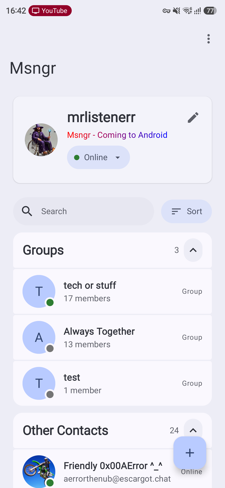</a></td>
    <td align="center"><a href="docs/screenshots/contact-actions.png">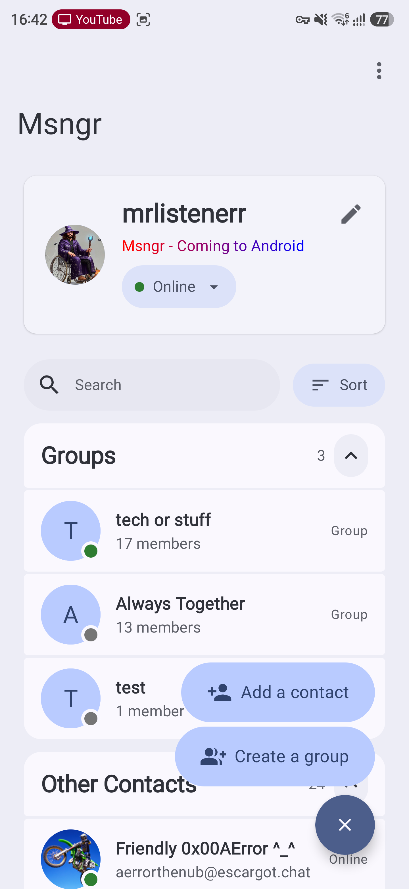</a></td>
    <td align="center"><a href="docs/screenshots/sort-and-filter.png">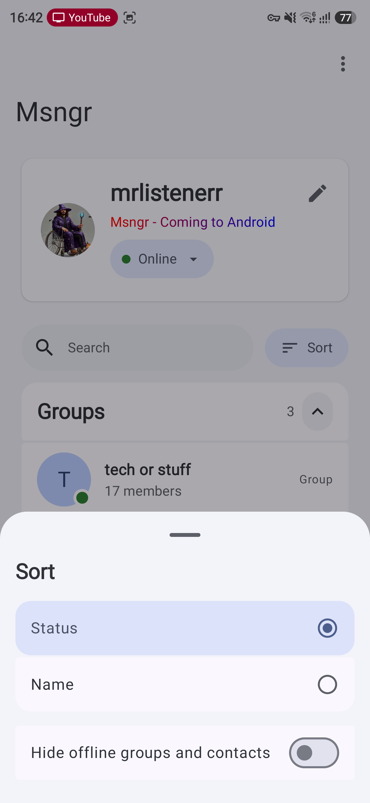</a></td>
  </tr>
</table>

### Make an entrance

<table>
  <tr>
    <th width="33%">Sign in</th>
    <th width="33%">Custom service</th>
    <th width="33%">Edit your profile</th>
  </tr>
  <tr>
    <td align="center"><a href="docs/screenshots/sign-in.png">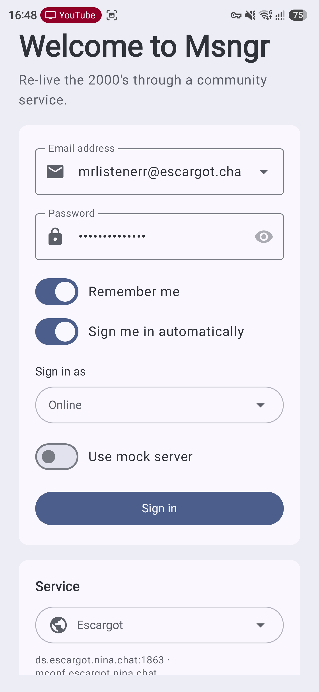</a></td>
    <td align="center"><a href="docs/screenshots/custom-service.png">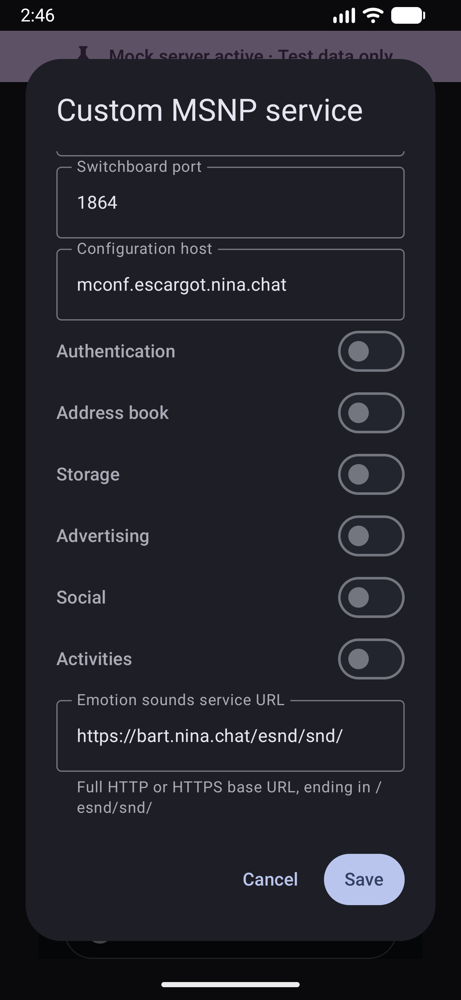</a></td>
    <td align="center"><a href="docs/screenshots/edit-profile.png">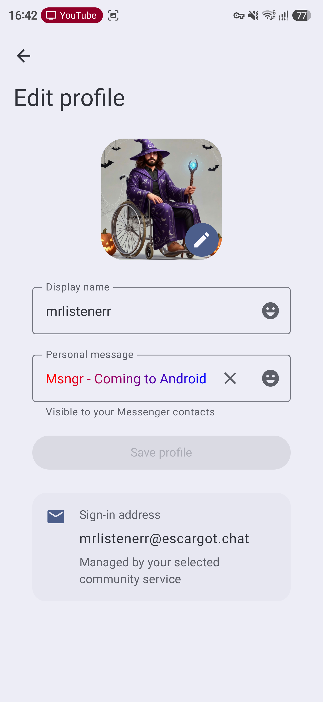</a></td>
  </tr>
</table>

### Make it yours

<table>
  <tr>
    <th width="33%">Messenger Plus! colors</th>
    <th width="33%">Display pictures</th>
    <th width="33%">Custom main color</th>
  </tr>
  <tr>
    <td align="center"><a href="docs/screenshots/messenger-plus-colors.png">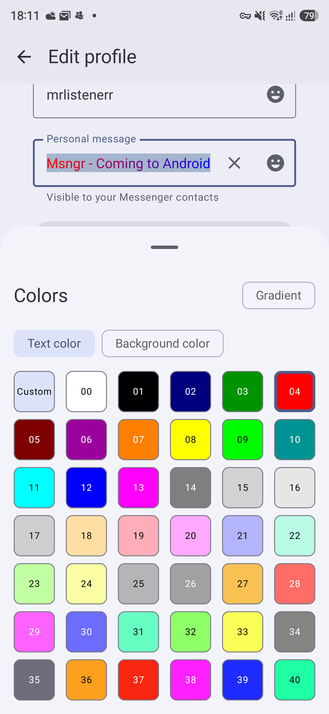</a></td>
    <td align="center"><a href="docs/screenshots/display-pictures.png">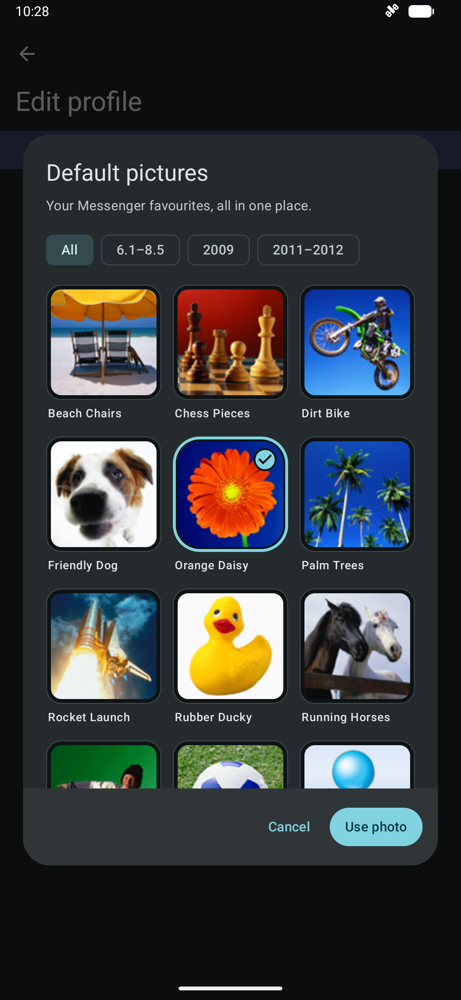</a></td>
    <td align="center"><a href="docs/screenshots/main-color.png">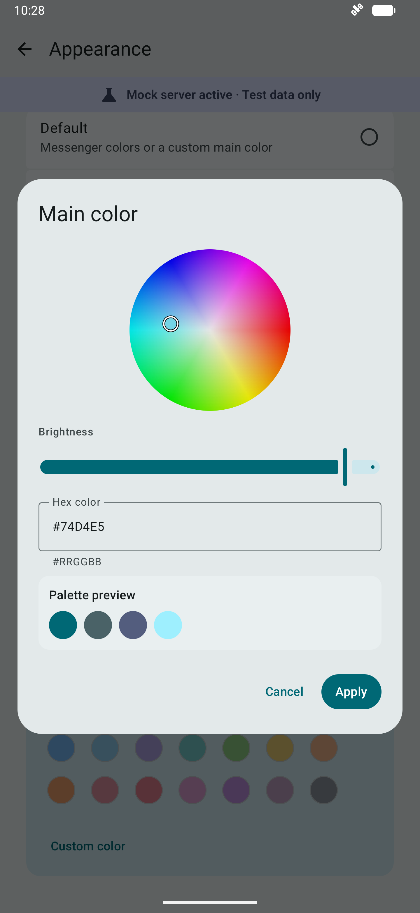</a></td>
  </tr>
</table>

Style names and personal messages with text and background colors, including gradients.
Choose a classic display picture or build an app palette from your own main color.

### Bring back the Messenger look

<table>
  <tr>
    <th width="33%">Appearance & scene controls</th>
    <th width="33%">Classic scene collection</th>
    <th width="33%">Scenes in dark mode</th>
  </tr>
  <tr>
    <td align="center"><a href="docs/screenshots/appearance-settings.png">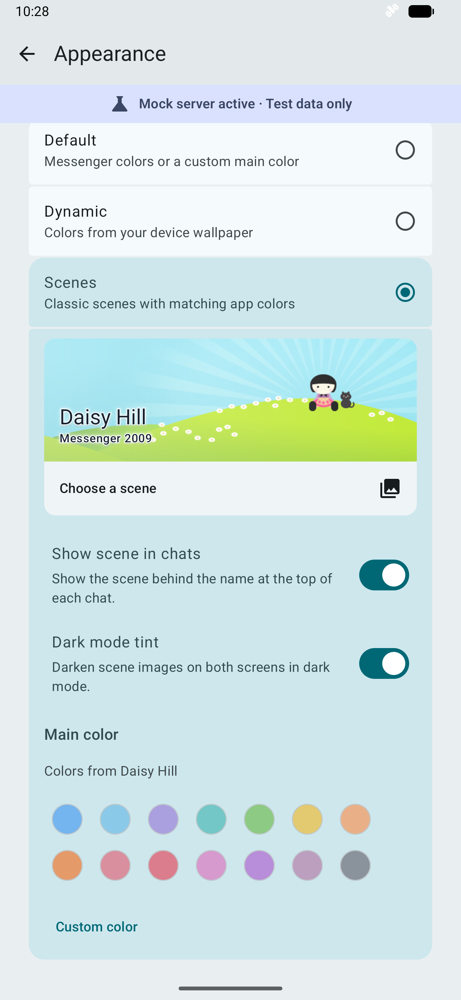</a></td>
    <td align="center"><a href="docs/screenshots/scene-picker.png">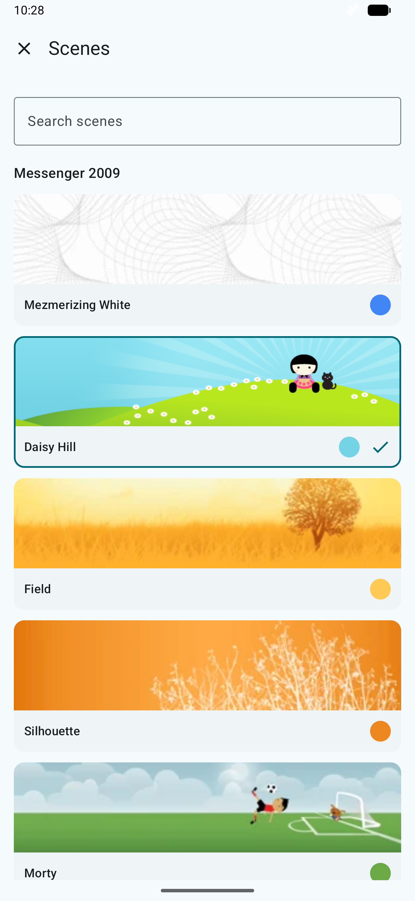</a></td>
    <td align="center"><a href="docs/screenshots/scene-dark.png">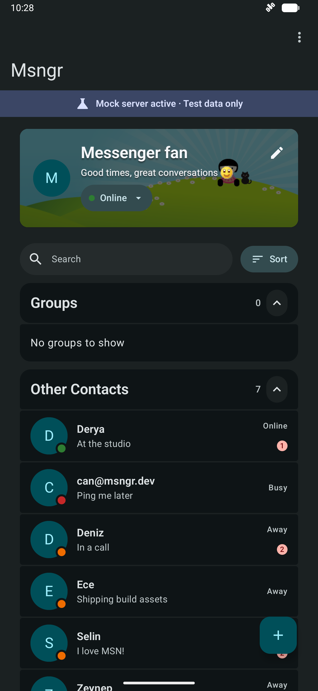</a></td>
  </tr>
</table>

Classic [Messenger scenes](docs/SCENES.md) supply artwork and matching light or dark palettes.
Control scene artwork in chats and its tint in dark mode independently.

### Keep the conversation going

<table>
  <tr>
    <th width="33%">Private messages & nudges</th>
    <th width="33%">Classic emoticons</th>
    <th width="33%">Animated winks</th>
  </tr>
  <tr>
    <td align="center"><a href="docs/screenshots/private-chat.png">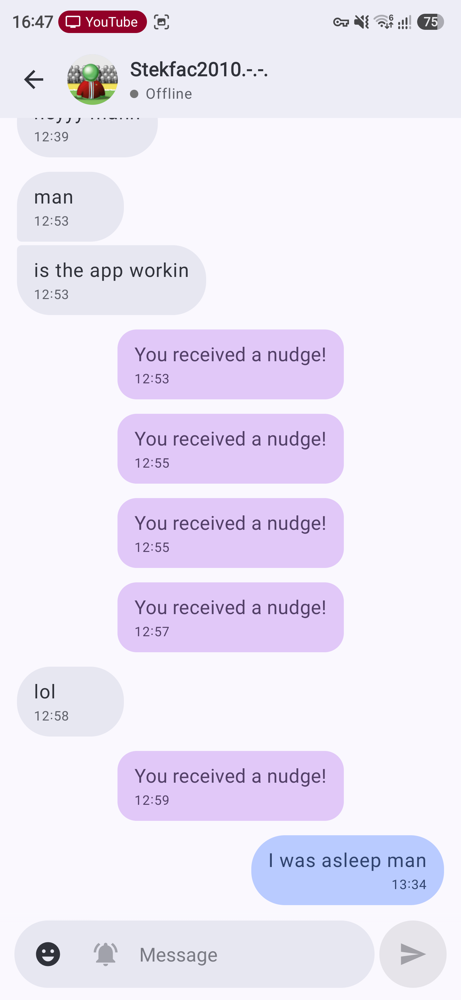</a></td>
    <td align="center"><a href="docs/screenshots/emoticon-picker.png">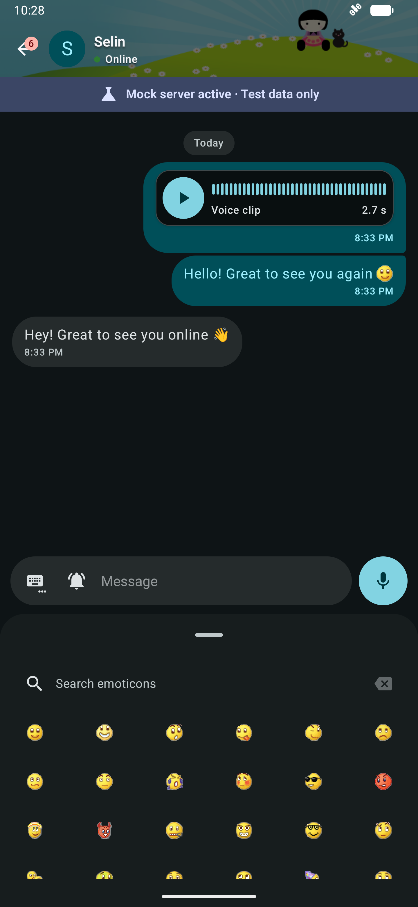</a></td>
    <td align="center"><a href="docs/screenshots/wink-picker.png">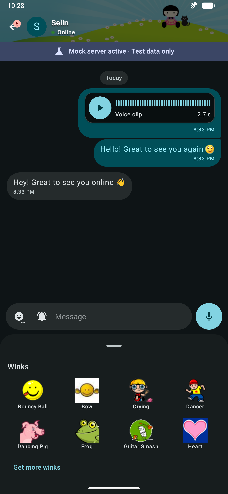</a></td>
  </tr>
</table>

### Say more than words

<table>
  <tr>
    <th width="33%">Voice clips</th>
    <th width="33%">Handwriting</th>
    <th width="33%">Group conversations</th>
  </tr>
  <tr>
    <td align="center"><a href="docs/screenshots/voice-clips.png">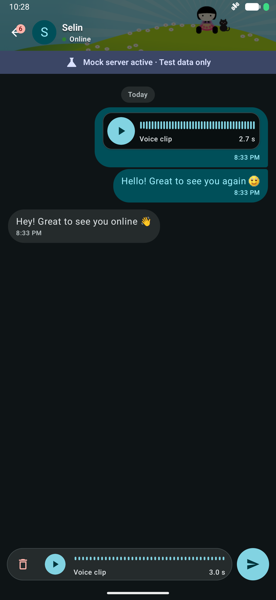</a></td>
    <td align="center"><a href="docs/screenshots/handwriting.png">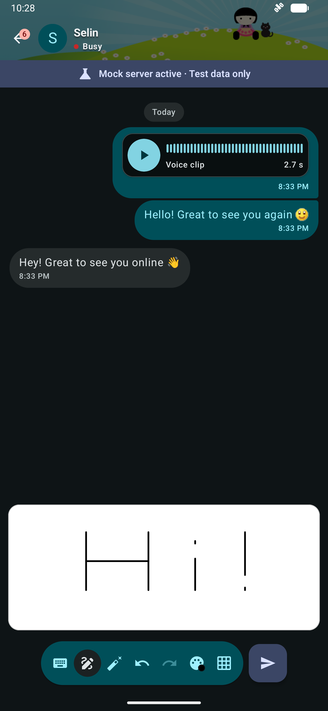</a></td>
    <td align="center"><a href="docs/screenshots/group-chat.png">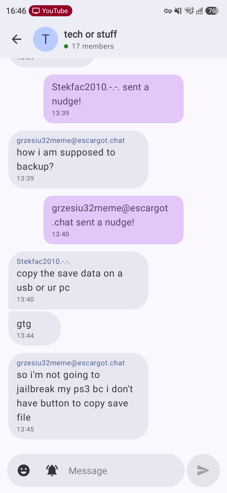</a></td>
  </tr>
</table>

[Voice clips](docs/VOICE_CLIPS.md) are available in online one-to-one chats. Handwriting and
[winks](docs/WINKS.md) also work in groups when the online members support them.

### Bring the group along

<table>
  <tr>
    <th width="33%">Create a group</th>
    <th width="33%">Members & roles</th>
    <th width="33%">Contact controls</th>
  </tr>
  <tr>
    <td align="center"><a href="docs/screenshots/create-group.png">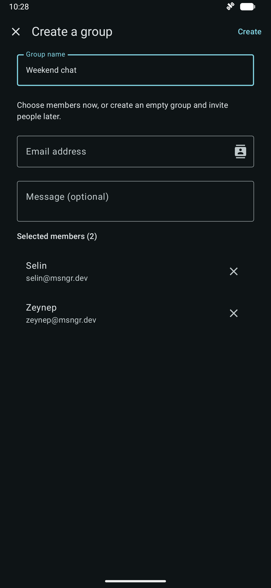</a></td>
    <td align="center"><a href="docs/screenshots/group-details.png">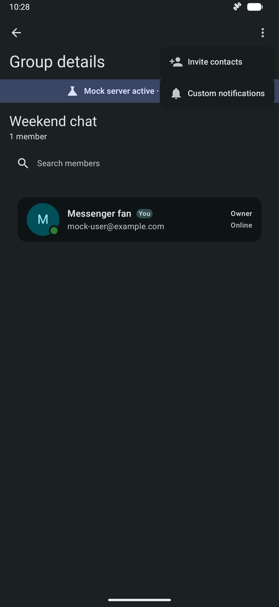</a></td>
    <td align="center"><a href="docs/screenshots/contact-profile.png">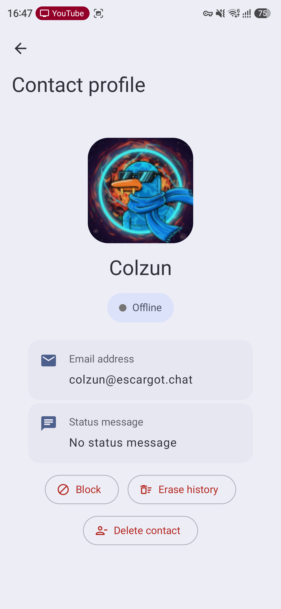</a></td>
  </tr>
</table>

### Stay in control

<table>
  <tr>
    <th width="33%">Active sessions</th>
    <th width="33%">Requests & invitations</th>
    <th width="33%">In-app notifications</th>
  </tr>
  <tr>
    <td align="center"><a href="docs/screenshots/active-sessions.png">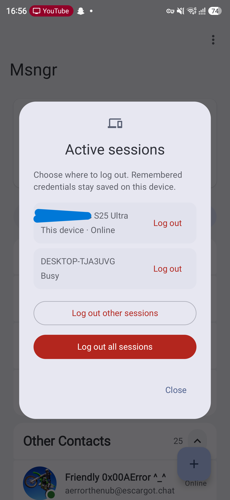</a></td>
    <td align="center"><a href="docs/screenshots/requests-and-invitations.png">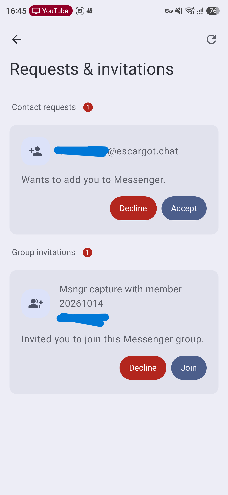</a></td>
    <td align="center"><a href="docs/screenshots/notification-settings.png">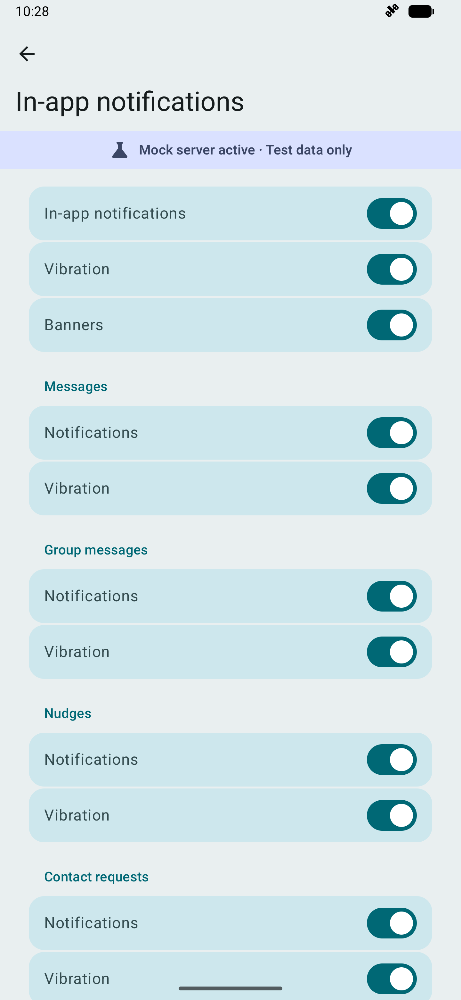</a></td>
  </tr>
</table>

Manage [connected sessions](docs/MULTI_PRESENCE.md), respond to requests and invitations,
and choose which events appear while you use the app.

### Choose your setup

<table>
  <tr>
    <th width="33%">Settings</th>
    <th width="33%">Connection & picture sync</th>
    <th width="33%">App updates</th>
  </tr>
  <tr>
    <td align="center"><a href="docs/screenshots/settings.png">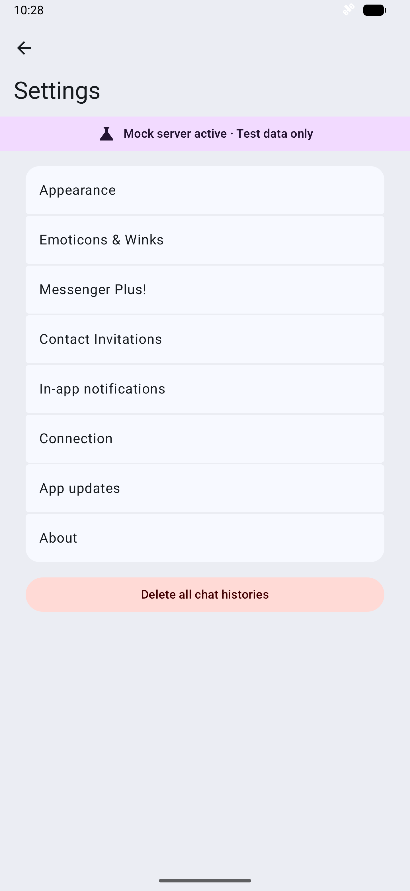</a></td>
    <td align="center"><a href="docs/screenshots/connection-settings.png">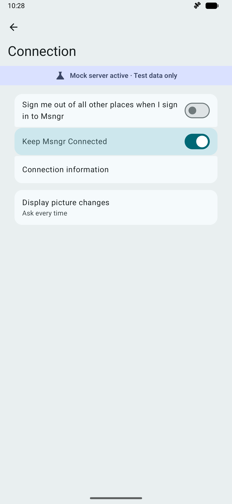</a></td>
    <td align="center"><a href="docs/screenshots/app-updates.png">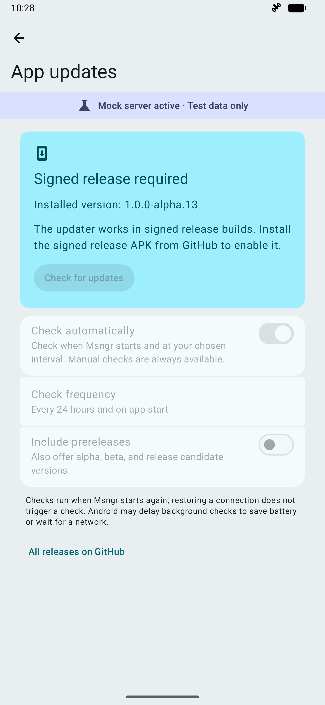</a></td>
  </tr>
</table>

The updater requires a signed release build; its controls are disabled in the debug capture.
See [app updates](docs/APP_UPDATES.md) for the release workflow.

### Android alerts & offline delivery

<a href="docs/screenshots/android-notifications.png">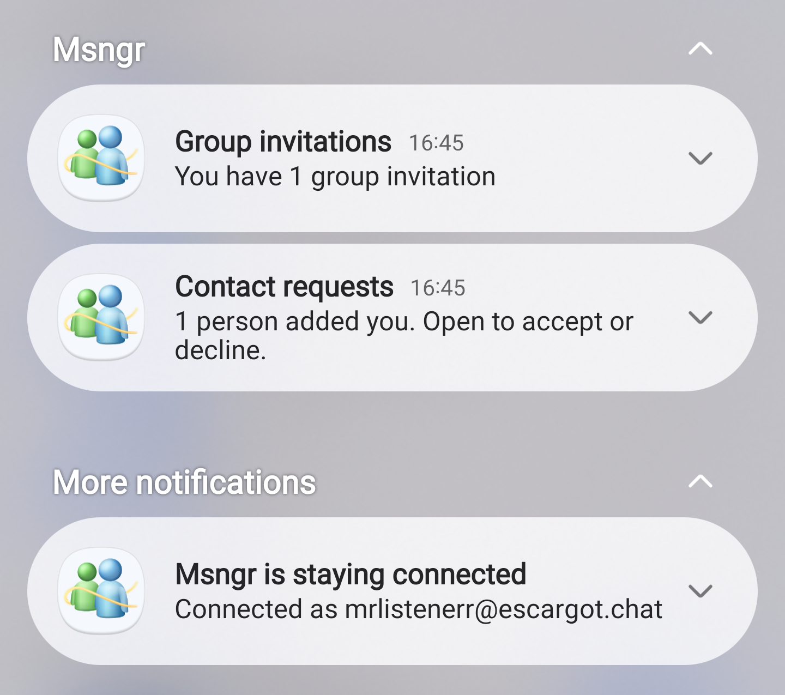</a>

Android alerts surface requests and invitations alongside the ongoing background connection.

<a href="docs/screenshots/offline-message-notice.png">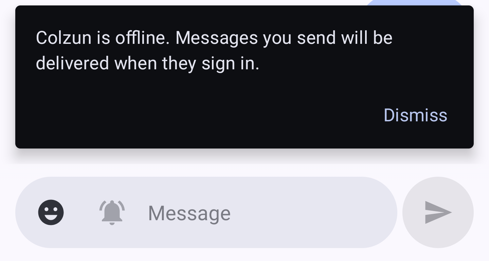</a>

An offline private-chat notice explains queued delivery. See the
[delivery limits](docs/OFFLINE_MESSAGES.md#delivery-limits) for the difference between submitting a
message and confirming that it reached its recipient.

## Services and compatibility

Msngr is a **client**: you sign in with an account from your selected community service.

| Service or mode | Current scope |
| --- | --- |
| **Escargot** | Built-in preset. The implementation supports private chats, offline messages, groups, invitations, and session management on Escargot. |
| **CrossTalk** | Built-in endpoint preset. Feature availability depends on the service; the Escargot checks do not establish equivalent CrossTalk coverage. |
| **Custom MSNP service** | Configure notification and switchboard ports, a configuration host, and optional companion-service endpoints. Requires compatible MSNP18 authentication and services. |
| **Mock server** | Debug builds include a local simulation for exploring and testing the interface without a live service account. |

**Android 7.0+ (API 24)** is supported by the app's minimum SDK setting. The project currently
compiles and targets API 37.

This is an evolving implementation of the Messenger experience. Voice/video calls, general file
transfers, and ad hoc multi-person switchboard chats are outside its current scope. Persistent
groups support messaging only while another member is online; offline private messaging is
documented separately. Optional endpoint fields in the custom-service form do not imply that
every associated Messenger feature is implemented.

Two service details are worth knowing: Escargot currently does not deliver custom contact-request
messages to the receiver, although group invitation messages work; and a submitted message is
not a delivery receipt. See the [request-message notes](docs/REQUEST_MESSAGES.md) and
[offline-message limits](docs/OFFLINE_MESSAGES.md#delivery-limits).

## Getting started

1. Install a build of Msngr on an Android device, or [build it from source](#build-from-source).
2. Select **Escargot**, **CrossTalk**, or **Custom** on the sign-in screen. You need an account
   with that service; account registration is handled by the service.
3. Enter your service credentials and choose your initial presence. **Remember me** and
   **Sign me in automatically** are optional.
4. Allow notifications if you want Android alerts. **Keep Msngr Connected** in Settings controls
   the background connection and its ongoing notification.
5. Open a contact or group to chat. Use **+** to add a contact or create a group, and the main
   menu's **Requests & invitations** page to respond to incoming requests.

The **Use mock server** switch shown in the screenshots is available in debug builds.
Background delivery uses a direct Messenger connection. Android notification permissions,
channel settings, and process restrictions affect delivery; force-stopping the app requires
opening it again. See [background behavior and device setup](docs/PUSH_NOTIFICATIONS.md).

## Build from source

### Clone and update the checkout

Install Git and Python **3.11+**, then clone the repository and initialize its pinned
dependencies using the setup helper:

```sh
git clone https://github.com/aralozkaya/Msngr.git
cd Msngr
python tools/setup_dependencies.py
```

Use `python3` in these commands if that is your Python executable's name.

For contributions through a fork, use your fork's clone URL instead. If you already
cloned the repository, run the same helper from the repository root:

```sh
python tools/setup_dependencies.py
```

After pulling changes or switching branches, synchronize the submodules to the commits
selected by that checkout. For example, to update a clean checkout on `main`:

```sh
git switch main
git pull --ff-only
git fetch origin --tags
python tools/setup_dependencies.py
```

Run the helper after switching to another branch as well. It downloads libsiren and
only Ruffle's version, license, and dependency metadata. Ruffle's upstream test SWFs
are excluded to avoid antivirus detections and long Windows test-file paths. Its
submodule is configured to skip automatic full checkouts; do not use a recursive clone
or force a full Ruffle checkout. Normal APK builds use the committed, verified runtime.

Use the pinned commits: `git submodule update --remote` selects different dependency
versions and is intended for a reviewed dependency update. GitHub's **Download ZIP**
does not include submodule metadata, so use a Git clone for development.

### Set up Android Studio and the SDK

Open the **repository root** in Android Studio with support for the Android Gradle Plugin
version in [the version catalog](gradle/libs.versions.toml). Select **JDK 21** as the Gradle JDK to match CI, and install these packages
through Android Studio's SDK Manager:

| Package | Version |
| --- | --- |
| Android SDK Platform | API 37.1 (`platforms;android-37.1`) |
| Android SDK Build-Tools | 36.0.0 |
| Android NDK (Side by side) | 28.2.13676358 |
| CMake | 3.22.1 |

Accept the SDK licenses. Configure the SDK location through Android Studio, an
`ANDROID_HOME` environment variable, or an untracked `local.properties` file containing
`sdk.dir=/path/to/Android/Sdk`. Set `JAVA_HOME` to JDK 21 for command-line builds.
Use the included **Gradle wrapper**; a separate Gradle installation is unnecessary.

Python **3.11+** is needed for dependency setup, maintenance scripts, and their tests.
Normal APK builds use the bundled, verified Ruffle runtime and do not require Node.js,
npm, or a Rust toolchain. Keep account credentials and signing keys out of Git.

### Build and run

Run these commands from the repository root. On Windows PowerShell:

```powershell
.\gradlew.bat :app:assembleDebug
.\gradlew.bat :app:installDebug
```

The install command requires a running Android emulator or a connected device with USB
debugging enabled. Launch Msngr and use the debug-only **Use mock server** switch for
development without a service account, or sign in through the app to use a real service.
On macOS or Linux, use `./gradlew` in place of `.\gradlew.bat`.

To build both APK variants and compile the device tests:

```powershell
.\gradlew.bat :app:assembleDebug :app:assembleRelease :app:assembleDebugAndroidTest
```

| Output | Location |
| --- | --- |
| Debug APK, signed with the debug key | `app/build/outputs/apk/debug/app-debug.apk` |
| Release APK, unsigned locally | `app/build/outputs/apk/release/app-release-unsigned.apk` |
| Instrumentation test APK | `app/build/outputs/apk/androidTest/debug/app-debug-androidTest.apk` |

### Develop and test a change

Create a branch before editing, for example `git switch -c feature/my-change`.
Kotlin and Compose code lives in `app/src/main/java`, JVM tests in `app/src/test`,
device tests in `app/src/androidTest`, and the native codec bridge in `app/src/main/cpp`.
The source dependencies under `third_party` are separate Git repositories; keep local
codec changes in the reviewed patch described in [dependency maintenance](docs/DEPENDENCIES.md).

Run the JVM tests and dependency-tooling tests before opening a pull request:

```powershell
.\gradlew.bat :app:testDebugUnitTest
python -m unittest discover -s tools/tests -v
```

With an emulator or device connected, run instrumentation tests using
`.\gradlew.bat :app:connectedDebugAndroidTest`. To target just the two bundled libraries:

```powershell
.\gradlew.bat :app:connectedDebugAndroidTest "-Pandroid.testInstrumentationRunnerArguments.class=org.aralozkaya.msngr.WinkInstrumentedTest,org.aralozkaya.msngr.VoiceClipInstrumentedTest"
```

Regular tests use synthetic fixtures, mock clients, and in-memory transports; they need
no community-service credentials. Live interoperability tests are opt-in and documented
with their features. Device tests can change the selected account/session, so check the
app's sign-in state afterward. Include the checks you ran in your pull request.

### Pull request checks

**Build and test Android** runs on every pull request's merged result, pushes to `main`, and
merge queues. It runs the unit tests, builds the debug and release APKs, and compiles the
instrumentation-test APK. Unit-test reports are retained as workflow artifacts for seven days.
Device instrumentation tests still require an emulator or device.

**Dependency security** scans resolved Android dependencies and the pinned third-party
libraries on PRs and daily. Dependabot opens dependency update PRs, and a separate daily
workflow updates Ruffle's source pin and matching runtime together. See
[dependency updates, scan coverage, and existing findings](docs/DEPENDENCIES.md).

Trusted dependency update PRs are eligible for automatic squash merging after their current
commit passes the Android build and vulnerability checks. Existing GitHub review and CodeQL
requirements still apply. Other contributions continue through the normal review process.

The **Require Android CI** ruleset requires this check from GitHub Actions with the latest
`main` changes before merging. It has no bypass actors, so approval bypass still requires a
successful build. Its importable configuration is checked in at
[`.github/rulesets/require-android-build.json`](.github/rulesets/require-android-build.json).
Keep the job name, this configuration, and the live ruleset's status-check name in sync.

### Validate release packaging

The **Build release APKs** workflow compiles, packages, verifies, and signs APKs when
all four Android signing secrets are configured; otherwise it produces a debug APK
and an explicitly unsigned release APK. It generates `SHA256SUMS.txt` in either case.
Partial signing configuration fails with a message naming the missing secret.

To exercise that pipeline without publishing, open **Actions → Build release APKs →
Run workflow**, select the branch to validate, and enter a supported version tag such
as `v1.2.3`. Download the `release-apks` workflow artifact to inspect the output.
The manual run never attaches files to a GitHub release.

Publishing a GitHub release runs the same packaging pipeline for its tag. APK compilation
runs independently of the vulnerability scan; publication requires both to pass. Known
security findings remain a release blocker until fixed or reviewed with a documented,
narrowly scoped exception. The security gate is retained for release validation as well.

## Downloads

Find debug and release APKs on [GitHub Releases](https://github.com/aralozkaya/Msngr/releases),
along with SHA-256 checksums. Files labelled **unsigned** require signing before installation.

Release tags define the app version: `v1.2.3` becomes **1.2.3** in every APK's metadata and
**Settings → About**. Prereleases use `v1.2.3-alpha.1`, `v1.2.3-beta.1`, or `v1.2.3-rc.1`.
Android version codes are derived from the tag and increase from alpha to beta to release
candidate to stable, then with each patch, minor, or major version. Supported ranges are
major 0–209, minor/patch 0–99, and prerelease number 1–99; malformed tags stop the build.
The GitHub release title is free-form; its tag is the version source.

Local builds use the nearest release tag in the checked-out Git history for both the version
name and Android version code. Fetch new release tags with `git fetch origin --tags` when
updating the checkout. To override the version, pass `-PreleaseTag=v1.2.3` to Gradle or set
`RELEASE_TAG`; the Gradle property takes priority. Builds without a matching Git tag default
to **1.0.0-dev**.

## Under the hood

Kotlin, Jetpack Compose, Material 3 Expressive, StateFlow, WorkManager, and a native MSNP18 client.
The client uses direct TCP connections for Messenger traffic and HTTPS companion services for
authentication, address books, and profile storage. There is no HTTP-tunnel fallback.

Remembered credentials are encrypted on the device with Tink and Android Keystore. Conversation
history is stored separately in private app storage and scoped by account, service, and mock/real
mode. Credential encryption does not provide end-to-end chat encryption.

<details>
<summary>Detailed implementation notes</summary>

### Current implementation

- Each remembered account has its own AES-256-GCM encrypted `StoredAccountDto` for credentials
  and community-server overrides. The encryption keyset is protected by Android Keystore through
  Tink. Accounts are identified by normalized email, notification-server host/port, and mock/real
  mode. Saved accounts are labeled with their service in the login screen's email selector.
- `LoginActivity` validates remembered credentials through the client before opening authenticated
  activities. Failed automatic login clears only the credentials and returns to the form.
- The main screen consumes live `StateFlow` contact data, follows presence changes, sorts by status
  or name, hides offline contacts, edits presence, and routes contact taps to chat. Its profile card
  opens a dedicated editor for the user's picture, display name, and personal message.
- GIF display pictures animate across the app and retain their animation when selected, restored,
  cached, transferred, or downloaded. See [animated-picture compatibility](docs/ANIMATED_PROFILE_PICTURES.md)
  for the native Messenger Soccer packet investigation and decoder details.
- The contacts FAB adds contacts by IM email address, using the native Messenger SOAP and MSNP
  invitation flow with an optional message, validation, loading, failure, and success feedback. Mobile numbers
  and categories are not included. See [`docs/ADDING_CONTACTS.md`](docs/ADDING_CONTACTS.md).
  Debug builds expose **Use mock server** on the login screen for packet-free UI testing, including
  a simulated add delay and a centered Material 3 Expressive loading overlay.
- Contacts can be deleted from the long-press menu or their profile, after confirmation with an
  optional **Also block this contact** checkbox (off by default). Saved chat history is retained,
  and deleted blocked contacts remain in Blocked contacts. The mock server supports the same flow
  without packets. See [`docs/DELETING_CONTACTS.md`](docs/DELETING_CONTACTS.md).
- Chat supports UTF-8 text, the 69 built-in MSN emoticon shortcuts, typing events, MSNP datacast
  nudges, unread counts, and haptic feedback for incoming messages and nudges. Emoticons can use
  either the [original Messenger artwork](app/src/main/MSN_EMOTICONS.md) or modern Unicode glyphs.
  Account- and service-scoped conversation history is saved as paged files in private app storage, loads older
  pages on demand while scrolling, and survives app restarts, reconnections, and contact presence
  changes.
- Private chats support offline text and emoticons on Escargot. Queued messages download at login,
  retain their original timestamps, notify through the Messages channel, and are removed from the
  server only after durable local storage. Retries and reconnects deduplicate server message IDs.
  Offline nudges and typing are disabled. See [`docs/OFFLINE_MESSAGES.md`](docs/OFFLINE_MESSAGES.md).
- Existing accepted MSNP18 groups (circles) appear in a separate Groups section. Group chats
  support text, typing, nudges, sender names, member details, separate saved histories, and Android
  message notifications with inline replies. See [`docs/GROUP_CHATS.md`](docs/GROUP_CHATS.md).
- The expandable FAB creates owner-only groups or groups with initial invitees. Group details lets
  owners and administrators invite members and non-owners leave. Online and offline invitations
  share the **Requests & invitations** page with contact requests, with matching Material 3
  Expressive cards and pull-to-refresh. Group invitations have their own Android notification channel.
  See [`docs/GROUP_CREATION.md`](docs/GROUP_CREATION.md). Custom invitation messages and the current
  Escargot contact-message limitation are documented in [`docs/REQUEST_MESSAGES.md`](docs/REQUEST_MESSAGES.md).
- Android notifications use independent Messages, Nudges, Contact signed in, and Offline messages channels. A standard
  remote-messaging foreground service keeps the direct MSNP connection alive in the background.
  Message notifications support inline replies and interrupted sessions reconnect with capped,
  network-aware backoff.
- Other Messenger sessions for the same account identify this client by Android's configured device
  name (or its model if no name is available). The name is refreshed on each sign-in and reconnect.
  With multiple active sessions, Log out opens a device list with individual, current-device,
  other-session, and all-session logout actions. Remote sign-out returns to login and prevents
  automatic reconnection, background restoration, and queued notification actions from signing
  the client back in. Remembered credentials remain available for explicit sign-in.
  An account-specific Settings toggle, off by default, can sign out every other place
  whenever Msngr signs in.
  See [`docs/MULTI_PRESENCE.md`](docs/MULTI_PRESENCE.md) for live verification.
- Profiles, appearance, emoticon, Messenger Plus!, contact invitation defaults, and background connection settings are stored
  separately for each account and service, including separate mock and real profiles for the same
  email. Switching service or mock mode loads the corresponding saved login options. Turning off
  Remember me immediately removes that account's saved
  credentials, profile, and preferences; turning off automatic sign-in keeps the profile for manual
  login. Unremembered profile settings are cleared on logout. All saved chat histories can be deleted
  together after a confirmation prompt.
- Upgrading from shared or email-only profile storage keeps remembered credentials under their
  recorded service and mode. Ambiguous local profile overrides and UI preferences are reset so
  mock values cannot be restored into a real account; profiles start from the server's values.
  Old email-only conversation files remain on disk, but are not imported into a service's history
  because their original mock/real mode cannot be established.

Background behavior, Android settings, and device verification are documented in
[`docs/PUSH_NOTIFICATIONS.md`](docs/PUSH_NOTIFICATIONS.md).

### MSNP backend boundary

`protocol/Msnp18Protocol.kt` contains MSNP18 negotiation, presence, UUX/UBX personal-message,
typing, text, and nudge support, an incremental wire-frame decoder, and a raw TCP transport. The app
uses direct, proxy-bypassing TCP sockets for both notification-server and switchboard MSNP traffic;
there is no HTTP-tunnel fallback. `MockMsnp18Client` exercises the same contact/message/event boundary
without depending on a community server account. The selected service's HTTPS SSO and SOAP endpoints
are separate companion services and do not carry MSNP wire traffic.

The endpoint presets and protocol behavior were checked against:

- <https://wiki.nina.chat/wiki/Protocols/MSNP/How_to_move>
- <https://git.ugnet.gay/CrossTalk/reroute>
- <https://github.com/pidgin/retro-prpl/tree/main/msn>
- <https://git.ugnet.gay/CrossTalk/msn-pecan>

</details>

| Documentation | What you will find |
| --- | --- |
| [Private offline messages](docs/OFFLINE_MESSAGES.md) | Queue retrieval, timestamps, deduplication, and delivery limits. |
| [Group chats](docs/GROUP_CHATS.md) · [Group creation](docs/GROUP_CREATION.md) | Circles, membership, invitations, roles, and interoperability checks. |
| [Adding contacts](docs/ADDING_CONTACTS.md) · [Deleting contacts](docs/DELETING_CONTACTS.md) | Contact management and retained history. |
| [Contact requests](docs/CONTACT_REQUESTS.md) · [Request messages](docs/REQUEST_MESSAGES.md) | Accept/decline flows, invitation text, and service limitations. |
| [Background notifications](docs/PUSH_NOTIFICATIONS.md) · [Active sessions](docs/MULTI_PRESENCE.md) | Android delivery, reconnects, device names, and remote logout. |
| [Picture synchronization](docs/PROFILE_PICTURE_SYNC.md) | Roaming identity, same-account picture transfers, removals, and desktop interoperability. |

## Made with AI? Yes, really.

AI tools were used to help make Msngr, including during development and writing this documentation.
That's part of how this project was made, and I want to be clear about it.

I'm a software engineer; using tools is kind of the job, lol. AI assistance doesn't change that
the technical decisions, the bugs, and the responsibility for the result are mine.

— Aral Özkaya

## Thanks

- **[Escargot](https://escargot.chat/) and the [NINA community](https://wiki.nina.chat/wiki/Protocols/MSNP/How_to_move)**
  for keeping Messenger usable and preserving the service and protocol knowledge that makes projects like this possible.
- **[CrossTalk](https://crosstalk.im/)** for its community service and the
  [reroute](https://git.ugnet.gay/CrossTalk/reroute) and
  [msn-pecan](https://git.ugnet.gay/CrossTalk/msn-pecan) references used by this project.
- **[Pidgin / retro-prpl](https://github.com/pidgin/retro-prpl)** for preserving implementations
  that help explain how these older protocols work.
- **[bernzrdo/msn-emoticons](https://github.com/bernzrdo/msn-emoticons)** for the preserved
  Messenger emoticon collection. See the repository's [artwork provenance notes](app/src/main/MSN_EMOTICONS.md).
- **The Kotlin, Android, Jetpack Compose, Material, and Tink maintainers** for the tools behind the app.
- **Everyone testing Msngr, sharing feedback, and still sending nudges** for giving it people to connect.

Msngr is an independent community project, unaffiliated with Microsoft, Escargot, NINA, or
CrossTalk. MSN Messenger, Windows Live Messenger, and Messenger Plus! names and artwork belong
to their respective owners.
